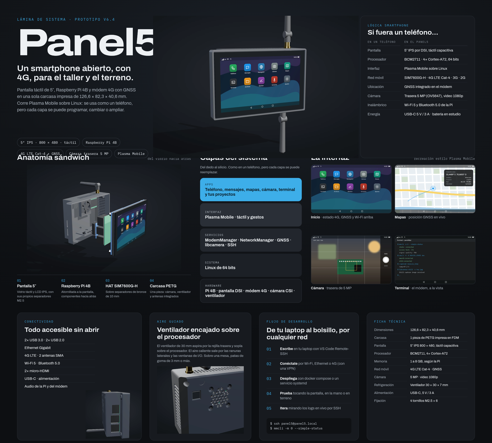
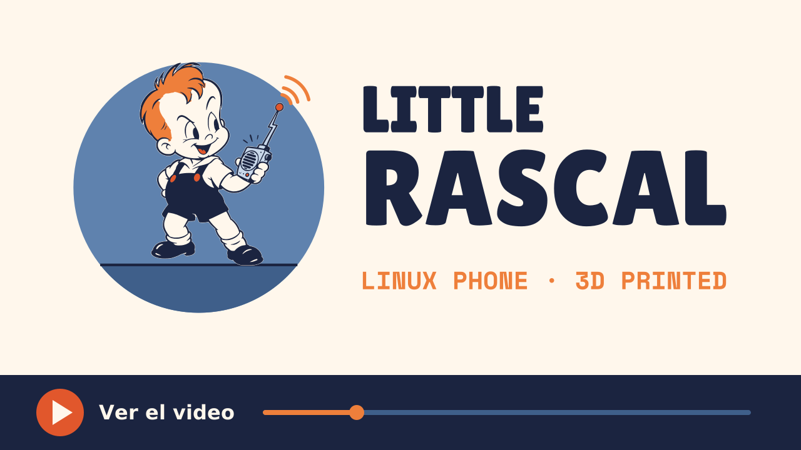

# One-Line Installation! 👾


[](https://www.youtube.com/watch?v=0w1ryLOrj5M)


# Plasma Mobile on Raspberry Pi 4


**A tested, working guide to install Plasma Mobile on Raspberry Pi 4** - the result of 2 years of research and testing.\

**See docs/Installation-Flow-Diagram.md for flow diagram**
## 🚀 Quick Start

### One-Line Installation:
```bash
curl -fsSL https://raw.githubusercontent.com/Philip-McColl-sd/Little_Rascal_Smart_Phone/main/scripts/setup.sh | bash
```

### Manual Installation:
```bash
wget https://raw.githubusercontent.com/Philip-McColl-sd/Little_Rascal_Smart_Phone/main/scripts/setup.sh
chmod +x setup.sh
./setup.sh
```

## 📖 What This Project Provides

This repository contains **the definitive solution** for installing Plasma Mobile on Raspberry Pi 4:

- ✅ **[Complete Installation Guide](docs/README.md)** - Detailed step-by-step instructions
- ✅ **[Automated Installation Script](scripts/setup.sh)** - One command setup
- ✅ **[Troubleshooting Flow Diagram](docs/Installation-Flow-Diagram.md)** - Visual guide to solve issues
- ✅ **[Quick Reference Card](docs/Quick-Reference-Card.md)** - Commands at your fingertips
- ✅ **Tested on real hardware** - Raspberry Pi 4B

## 🎯 Why This Works (And Why Others Don't)

After testing **EVERYTHING** for 2 years:

| Method | Status | Reason |
|--------|--------|--------|
| Ubuntu Server | ❌ Failed | No plasma-mobile packages |
| Manjaro ARM | ❌ Failed | No pre-built image |
| Mobian | ❌ Failed | No RPi4 support |
| postmarketOS | ❌ Complex | Requires building from source |
| **Raspberry Pi OS** | ✅ **SUCCESS** | Based on Debian (has packages!) |

**The Key Insight:**
```
Raspberry Pi OS → Based on Debian (Bookworm, now Trixie) → Has plasma-mobile packages → Success!
```

## 🚀 Features After Installation

- 📱 **Plasma Mobile** - KDE's mobile interface
- 🎨 **Touch-optimized UI** - Designed for mobile devices
- 📦 **Full Debian repository access** - Thousands of apps available
- 🔧 **Highly customizable** - Change everything
- 🔒 **Privacy-focused** - No Google, no tracking
- 🆓 **100% Free and Open Source**
- 📡 **Cellular voice (optional)** - Waveshare SIM7600G-H 4G HAT, see [docs/README.md Step 8](docs/README.md#step-8-connect-cellular-modem-optional--waveshare-sim7600g-h-4g-hat)

## 📋 Prerequisites

### Hardware Requirements
- **Raspberry Pi 4B** (4GB+ RAM recommended)
- **MicroSD card** (32GB+, Class 10/A1)
- **Power supply** for Raspberry Pi 4
- **Monitor** (HDMI or touchscreen)
- **Keyboard** (for initial setup)
- **Ethernet cable** OR WiFi credentials
- *Optional:* **Waveshare SIM7600G-H 4G HAT** + SIM card (for cellular voice, see [docs/README.md Step 8](docs/README.md#step-8-connect-cellular-modem-optional--waveshare-sim7600g-h-4g-hat))

### Software Requirements
- [Raspberry Pi Imager](https://www.raspberrypi.com/software/)
- Fresh Raspberry Pi OS (64-bit) Lite installation

## ⚡ Quick Installation Steps

1. **Flash Raspberry Pi OS Lite (64-bit)** with minimal configuration (username, password, SSH only)
2. **Boot and press ENTER** when you see "completed socket interaction"
3. **Run the installation script** (or follow [manual guide](docs/README.md))
4. **Reboot** and enjoy Plasma Mobile!

**Total time:** 30-60 minutes

## 🔧 Critical Success Factors

✅ **Use Raspberry Pi OS** (Debian-based)
✅ **Disable IPv6** before installing
✅ **Force IPv4** during package installation
✅ **Install SDDM** display manager
✅ **Use minimal** flash configuration

## 📊 Success Metrics

- ✅ **Reproduced repeatedly** on Raspberry Pi 4B following this guide
- ⏱️ **30-60 minutes** total installation time
- 📦 **150+ packages** installed automatically
- 💾 **3-4GB** disk space used
- 🚀 **30-45 seconds** boot time

## 🐛 Quick Troubleshooting

| Problem | Solution |
|---------|----------|
| Boot hangs at "completed socket interaction" | Press ENTER |
| Network errors with IPv6 | Disable IPv6 (see guide) |
| Terminal instead of GUI after reboot | Install SDDM: `sudo apt install sddm` |
| SSH connection fails after reboot | IP changed: `hostname -I` |
| SIM7600G-H modem stuck "searching" | Power cycle with SIM/antennas seated before power-on |

See [complete troubleshooting guide](docs/Installation-Flow-Diagram.md) for more.

## 🔧 Post-Installation Quick Configs

### Rotate Display (Portrait Mode)
```bash
sudo nano /boot/firmware/config.txt
# Add: display_rotate=1
sudo reboot
```

### Increase Performance
```bash
sudo nano /boot/firmware/config.txt
# Add: gpu_mem=256
sudo reboot
```

### Install More Apps
```bash
sudo apt search <app-name>
sudo apt install <app-name>
```

## 📚 Documentation

- **[📘 Complete Installation Guide](docs/README.md)** - Step-by-step manual installation
- **[🔄 Installation Flow Diagram](docs/Installation-Flow-Diagram.md)** - Visual troubleshooting flowchart
- **[📝 Quick Reference Card](docs/Quick-Reference-Card.md)** - Essential commands and fixes
- **[🤖 Automated Script](scripts/setup.sh)** - One-command installation

## 🤝 Contributing

Found an issue? Have an improvement?

1. Fork this repository
2. Make your changes
3. Test on a real Raspberry Pi 4
4. Sign off your commits (`git commit -s`) and submit a pull request - see [CONTRIBUTING.md](CONTRIBUTING.md)

## 📜 License

Copyright (C) 2025-2026 Philip McColl

| Content | License |
|---------|---------|
| `scripts/` (code) | [GPL-3.0-or-later](LICENSE) |
| `README.md`, `docs/` and images | [CC BY-SA 4.0](LICENSES/CC-BY-SA-4.0.txt) |
| Modified KDE `Logout.qml` embedded in `scripts/setup.sh` | [GPL-2.0-or-later](LICENSES/GPL-2.0-or-later.txt), © its original KDE authors |

The **Little Rascal** name and logo (`docs/little-rascal-logo*.png`) are **not** covered by these licenses: all rights reserved.

This software is provided **without any warranty** (see sections 15 and 16 of the GPL). The installer modifies system configuration (sudoers, SDDM, Plasma files): use it at your own risk.

### Trademarks

This is an independent project, not affiliated with or endorsed by Raspberry Pi Ltd or KDE e.V. "Raspberry Pi" is a trademark of Raspberry Pi Ltd. "KDE" and "Plasma" are trademarks of KDE e.V. All other trademarks belong to their respective owners.

## 🙏 Credits

**Created after 2 years of research and testing**

Special thanks to:
- KDE Plasma Mobile team
- Debian DebianOnMobile team
- Raspberry Pi Foundation
- Everyone who contributed to making mobile Linux possible

## 📞 Support & Community

- **Issues:** [GitHub Issues](https://github.com/Philip-McColl-sd/Little_Rascal_Smart_Phone/issues)
- **Discussions:** [GitHub Discussions](https://github.com/Philip-McColl-sd/Little_Rascal_Smart_Phone/discussions)
- **KDE Community:** [Plasma Mobile Matrix](https://matrix.to/#/#plasmamobile:matrix.org)

## 📈 Project Statistics

- **Development Time:** 2 years
- **Methods Tested:** 5+ different approaches
- **Status:** Working on Raspberry Pi 4B (Debian 13 Trixie)
- **Lines of Code in Installer:** 400+
- **Documentation Pages:** 4 comprehensive guides

## 🗺️ Roadmap

Future improvements:
- [ ] Add automated testing
- [ ] Create pre-built SD card images
- [ ] Support for RPi 5
- [ ] Performance optimization guide
- [ ] Video tutorial
- [ ] Screenshots and demos

## ⭐ Star This Repository

If this guide helped you get Plasma Mobile running, please **star this repository**! It helps others find this working solution.

## 🌟 Why Mobile Linux?

- **Privacy** - Full control over your device
- **Freedom** - Install any software you want
- **Customization** - Make it truly yours
- **Learning** - Understand how your system works
- **Sustainability** - Keep old hardware useful
- **Community** - Join the mobile Linux revolution

---

**Made with ❤️ by Philip McColl, for the community**

*This guide represents 2 years of dedication to making mobile Linux accessible on Raspberry Pi 4*

## 🔗 Quick Navigation

| Resource | Description |
|----------|-------------|
| [📘 Installation Guide](docs/README.md) | Complete step-by-step manual |
| [🔄 Flow Diagram](docs/Installation-Flow-Diagram.md) | Visual troubleshooting |
| [📝 Quick Reference](docs/Quick-Reference-Card.md) | Commands cheat sheet |
| [🤖 Auto Script](scripts/setup.sh) | Automated installer |
| [🏠 Plasma Mobile](https://plasma-mobile.org/) | Official website |

---


**📅 Version:** 1.0 | **📆 Date:** October 25, 2025 | **🧪 Tested:** Raspberry Pi 4B (4GB)
